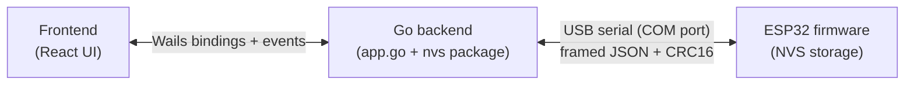
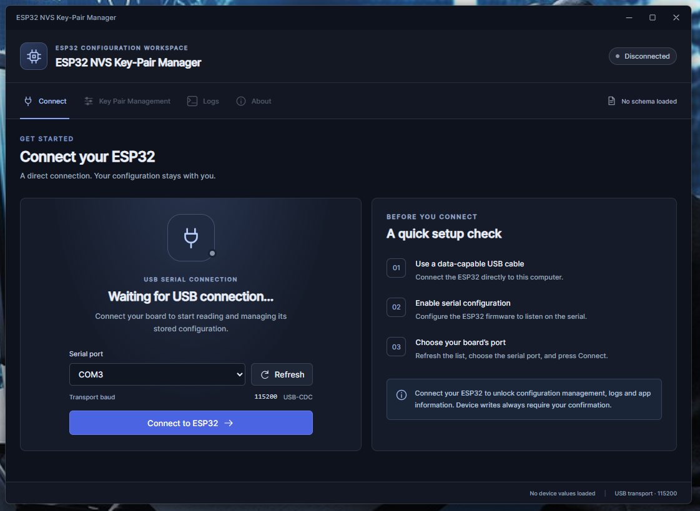
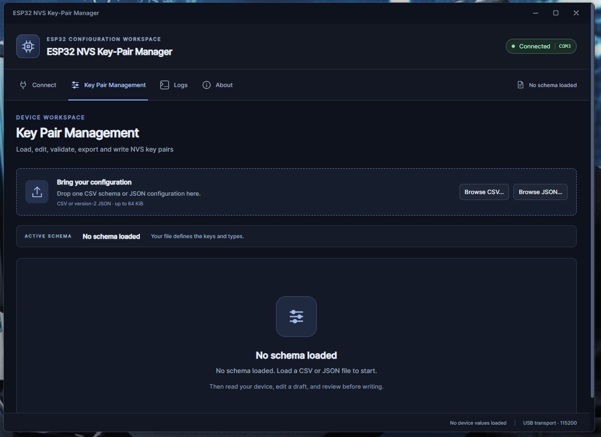

# ESP32 NVS Key-Pair Manager *(cross-platform)*

A Wails v3 desktop application for managing the GNSS ESP32's configuration over
USB. Load a CSV schema or version-2 JSON, read the device, edit a draft, review
selected changes, and explicitly write them. The four tabs are Connect, Key Pair
Management, Logs, and About.

> **ESP32 requirement:** the targeted ESP32 must run firmware with this app's companion
> serial handler that reads these frames and answers them (`hello`, `get`, `set`, `erase`). The app does nothing with a board that lacks it. 
> See the reference implementation in the GNSS firmware docs:  [entr0-pi/gnss/docs](https://github.com/entr0-pi/gnss/tree/main/docs). Of course, using this ESP32 firmware will work (with the flag ***SERIAL_CONFIG_ENABLE=1***)

## Quick start: no build needed

Download the binary for your platform from the
[Releases page](https://github.com/entr0-pi/arduino-nvs-desktop/releases) and
run it. That's it: no Go, Node.js or Wails install is needed.

- **Windows**: `esp32-nvs-manager-windows-amd64.exe` (x86-64 only).
  Windows 10/11 already includes the WebView2 runtime the app uses.
- **Linux**: `esp32-nvs-manager-linux-amd64` (x86-64 only). Make it executable
  (`chmod +x`). It needs the GTK 4 and WebKitGTK 6.0 runtimes, and your user
  needs serial-port access, usually through the `dialout` group.
- **macOS (Darwin)**: `esp32-nvs-manager-darwin-arm64` (Apple silicon) or
  `-amd64` (Intel). Make it executable (`chmod +x`). It uses the WebKit built
  into macOS. The binary is unsigned, so allow it once in System Settings →
  Privacy & Security.




1. On Connect, the app opens the COM port, waits for the board to boot and
   sends `hello`.
2. Each request is one framed JSON command (`get`, `set` or `erase`) with a
   sequence number and a CRC16 checksum.
3. The ESP32 replies with the same sequence number. If no reply arrives within
   1 s, the app resends the identical frame (up to 3 attempts).

### Frame format

Every message, in both directions, is one frame:

```text
<STX>{json payload}#CRC<ETX>
```

| Part | Bytes | Content |
|---|---|---|
| `STX` | `0x02` | Start of frame |
| payload | JSON | The command or reply |
| `#` | `0x23` | Separator before the checksum |
| `CRC` | 4 hex chars | CRC16-CCITT of the payload (poly `0x1021`, init `0xFFFF`), uppercase |
| `ETX` | `0x03` | End of frame |

A frame is at most 512 bytes from `STX` to `ETX`. Bytes outside a frame, such
as firmware log lines, are ignored. Frames with a bad CRC are dropped.

Example: reading `wifi/ssid` (`␂` = STX, `␃` = ETX):

```text
App → ESP32   ␂{"op":"get","seq":7,"ns":"wifi","key":"ssid"}#A505␃
ESP32 → App   ␂{"seq":7,"op":"get","ns":"wifi","key":"ssid","status":"ok","type":"string","value":"MyNetwork"}#EE1E␃
```

A `set` request also carries `type` (`int`, `uint`, `bool` or `string`) and
`value`. A refused command replies with `"status"` other than `"ok"`, an error
code in `message` (for example `not_found`, `read_only`, `forbidden`) and an
optional `detail`.

The application sends only `hello`, `set`, `get`, and `erase`. 

## Build and run

Requirements: Go 1.26 or newer, Node.js/npm, and the platform's Wails desktop
prerequisites. This Windows build was tested with Go 1.27.4, Node 24.13.0, and
WebView2. Both the Go module and CLI use Wails **v3.1.0**; the frontend runtime is
also pinned to **3.1.0**, matching that release. Go and npm lockfiles are included.

```powershell
go install github.com/wailsapp/wails/v3/cmd/wails3@v3.1.0
npm --prefix frontend ci
wails3 dev
```

Production build:

```powershell
wails3 build
.\bin\esp32-nvs-manager.exe
```

The About page shows the license as MIT and the version as the build date
(`YYYY-MM-DD`). Wails development, release, and Docker builds stamp this date
into the executable. Set `BUILD_DATE=YYYY-MM-DD` to override it for a build.

On Windows, `wails3 build` produces the standalone executable. `wails3 package`
uses the retained template installer tasks and requires the platform packaging
tools; an installer was not generated in this session.

### Cross-platform builds

This follows the official
[Wails cross-platform guide](https://v3.wails.io/guides/build/cross-platform/).
Windows builds use Go's native cross-compilation. Linux and macOS builds use the
`wails-cross` Docker image (Zig, GTK/WebKit headers and the macOS SDK), which the
Taskfiles pick automatically when needed.

Build the Docker image once (about 800 MB to download; Docker must be running
with Linux containers):

```sh
wails3 task setup:docker
```

Then build all four binaries with one command:

```sh
wails3 task build:all
```

Or build one target at a time:

```sh
wails3 build GOOS=windows GOARCH=amd64
wails3 build GOOS=linux   GOARCH=amd64
wails3 build GOOS=darwin  GOARCH=arm64
```

`build:all` writes these files to `bin/`. Upload them to a GitHub Release:

| Target | File |
|---|---|
| Windows amd64 | `esp32-nvs-manager-windows-amd64.exe` |
| Linux amd64 | `esp32-nvs-manager-linux-amd64` |
| macOS amd64 / arm64 | `esp32-nvs-manager-darwin-amd64`, `esp32-nvs-manager-darwin-arm64` |

A single `wails3 build GOOS=…` writes `bin/esp32-nvs-manager` (or `.exe`
for Windows) and overwrites the previous one.

| Target | On a Windows host | On a Linux host | On a macOS host |
|---|---|---|---|
| Windows | native Go | native Go | native Go |
| Linux | Docker | native if a C compiler is found and the arch matches, otherwise Docker | Docker |
| macOS | Docker | Docker | native |

Limitations: cross-compiled macOS binaries are bare, unsigned executables.
Making a `.app` bundle or DMG, signing and notarising need a Mac
(`wails3 package`). The Linux binary needs the GTK 4 and WebKitGTK 6.0 runtimes
on the target machine. Windows arm64 and Linux arm64 are not built. Windows
on ARM runs the amd64 build through its built-in emulation. For Linux arm64,
the `wails-cross` image compiles Linux with its own GCC, so it would need a
separate arm64 image run under emulation. Run `wails3 doctor` to check that
the Docker image is ready.

## Miscelanous

Wails generates `frontend/bindings/`; do not edit those files. Components use the
typed adapter in `frontend/src/services/wailsApi.ts`. No HTTP application server
or browser serial API is used. A Vite-only preview cannot exercise native ports,
dialogs, or file drops.

The dependency helper runs `npm ci` when package inputs change and skips it when
they match. This avoids replacing native Node modules while Vite holds them open
on Windows. Stop dev mode before changing dependencies or running a clean install.

## Use

1. Browse for one `.csv` schema or `.json` configuration, or drop it on the import
   panel. Go parses and validates it. Loading works offline; cancel preserves the
   current schema and draft. See `examples/`.
2. Select the board's serial port and Connect. A loaded schema is read
   automatically after the handshake. Loading another file while connected offers
   Read device rather than silently replacing draft edits.
3. Edit draft values and select changed keys. Conflicts require Keep draft or Take
   device. Forbidden rows are excluded from writes and export; a `read_only`
   refusal disables its namespace.
4. Write to ESP32 always requires confirmation. Namespaces are saved in the order
   gnss, ntrip, wifi, stopping at the first failure. A partial save identifies
   Saved, failed/unknown, and Not attempted rows. Nothing is rolled back or retried
   by the frontend. Read back verifies written namespaces; Saved and Verified are
   separate states.
5. Erase requires confirmation. An erased key cannot be set until the next boot
   seeds the default. Save as JSON works offline and warns about cleartext
   passwords. Export excludes forbidden keys and uses device values when a draft
   value is absent.

The application does not reboot the board. NTRIP configuration takes effect
within about 5 seconds; GNSS and WiFi configuration takes effect at the next boot.
Drafts, schema contents, and device values are never persisted in browser storage.
Logs contain operation messages, not raw frames or configuration contents.

Official [Wails development/build guidance](https://v3.wails.io/getting-started/your-first-app/)
and [troubleshooting](https://v3.wails.io/faq/) cover platform setup.

## Screenshots

| Main page | Key pair management |
|---|---|
|  |  |
